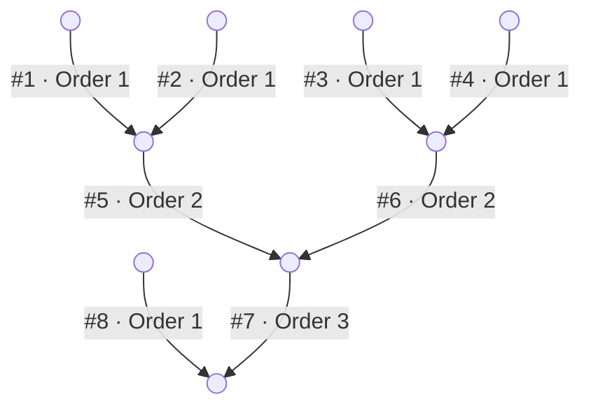
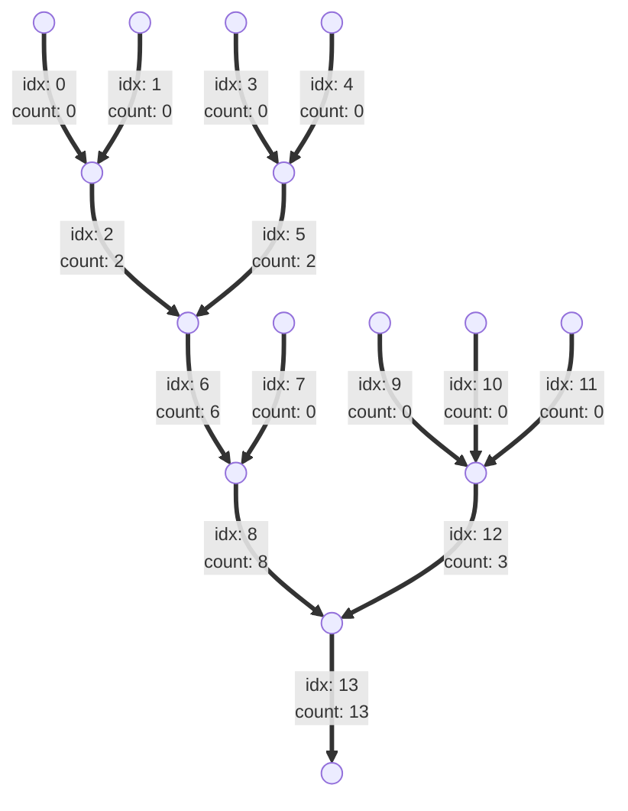

# Mathematical Derivations

Derivations of the Muskingum routing equation, and the forms the routing kernels rewrite it into to solve it. Every form
routes the same discharge. Each one needs fewer instructions per step, makes fewer of those instructions wait on the
step before, or stores less.

`river-route` computes in float32. Discharge and runoff are not known to more digits than a float32 holds, and a
float32 takes half the memory of a float64 and fits twice as many values in a vector register.

---

## Summary

1. River networks are directed acyclic graphs. Their rivers can be sorted so that every river comes after every river
   upstream of it, and `river-route` requires the order of a depth first search, which also makes every river's
   watershed one contiguous range of rows.
2. Rivers are routed in that order, so every river is routed after the rivers draining into it and reads their
   discharge rows. Routing each river's whole time series before the next river leaves every inflow known before a
   river's first step. Each river is then one recurrence, $Q_{t+1} = c_3 Q_t + b_t$, whose terms $b_t$ are all known in
   advance.
3. Computing $b_t$ first and adding $c_3 Q_t$ last, in one fused multiply-add, leaves one instruction per step that
   waits on the step before.
4. A vector register holds four float32 lanes, and one instruction computes all four. The kernels put four consecutive
   steps of one river in the lanes, so everything that does not wait on the step before is computed four steps at a
   time.
5. Applied eight times, the recurrence is $Q_{t+j} = c_3^{\,j} Q_t + S_j$, where the partial sums $S_j$ do not depend
   on $Q$. One multiply-add per eight steps waits on the steps before, against eight one step at a time.
6. Constants fold into the coefficients once per run, and a river's subcycles fold into one step, so neither costs
   anything per step.
7. Only the discharge and the runoff depth grow with the number of steps. Inflow, runoff volume, terms, and sub-reach
   discharge are computed where they are used and never stored.

## River Network Ordering

Rivers are often described as "networks" or "systems". When being modeled, river networks have a few properties that are useful
to take advantage of for mathematically more efficient algorithms.

1. They are "directed" -- meaning water only flows in one direction from upstream to downstream.
2. They are "acyclic" -- meaning there are no loops because water cannot flow upstream.
3. They are "dendritic" -- meaning they branch out when going upstream and merge when going downstream (ignoring braided rivers and deltas, for instance).

Rivers can be topologically sorted. Rather than sorting them from high to low by an attribute or an ID, topologically sorting means
sorting them in the order they are connected in the network. That is, from "upstream to downstream". The further upstream a river is
the earlier it should appear in the sorted list. A useful tool for conceptualizing and diagramming this is the Strahler stream order.
The Strahler order assigns the number 1 to the most upstream, or headwater, segments. When two segments of the same order merge, the
downstream segment is assigned an order 1 higher. If two different order merge, the downstream segment is assigned the higher of the
two inlet orders. Streams that are a headwater area have no upstream segments.

Some river datasets will have multiple segments in a row which have the same river order. In those cases, you could sort rivers of
the same order by increasing cumulative drainage area or another attribute that increases as you go downstream. There are multiple
valid ways to sort rivers which are all topologically sorted. It is not unique. The only requirement is that upstream segments
appear before downstream segments in the sorted list.

### Breadth First Search (BFS)

<div style="text-align: center;">



<figcaption><em>Figure 1: A topologically sorted river network labeled with Strahler stream orders.</em></figcaption>
</div>

In the diagram above, rivers 1 through 4 and 8 are headwaters with no upstream dependencies. Rivers 5 and 6 each receive two headwater
tributaries and are indexed after their upstream sources. River 7 merges two second-order streams and river 9, the outlet, appears last.
Another way to describe rivers that are topologically sorted is that they are sorted in order of independence. Segments at the top of
the list depend on no rivers and rivers further down the list depend on a greater number of upstream segments to get their inflow.
River 5's inflow depends on what is discharged from rivers 1 and 2. A river's discharge cannot be computed until all of upstream
contributors are known.

### Depth first search (DFS) order

A depth first search finds a topological order. It starts at each outlet and walks upstream, adding a river to the
order only after every river upstream of it has been added. Its order also places the rivers
upstream of each river in the rows immediately before it, so every river's whole upstream watershed is one contiguous
range of rows ending at that river. `river-route` requires this order (see the
[network file](io-file-schema.md#network-file) requirements).

<div style="text-align: center;">



<figcaption><em>Figure 2: A river network in DFS order, each river labeled with its <code>riverIndex</code> and <code>upstreamCount</code>.</em></figcaption>
</div>

A river's watershed is the rows from its `riverIndex` minus its `upstreamCount` to its `riverIndex`. In Figure 2,
river 5's watershed is rivers 3 through 5, river 6's is rivers 0 through 6, river 12's is rivers 9 through 12, and river
13's, at the outlet, is all 14 rivers.

Figure 1 is numbered in a topological order that is not a DFS order: rivers 3 and 4 fall between river 5 and its
upstream rivers 1 and 2. A depth first search from the outlet orders the same network 1, 2, 5, 3, 4, 6, 7, 8, 9.
`examples/migrate_v2_to_v3.py` sorts a network into DFS order.

## Muskingum Routing

The Muskingum routing method uses a conservation of mass approach to route flow through a river segment. It relates
the discharge at the current time step $Q_{t}$ to the discharge at the previous time step $Q_{t-1}$ and the inflow at 
both the current and previous time steps $I_{t}$ and $I_{t-1}$. This is also equivalently described and written as 
the discharge the next step relative to the discharge at the current step, $Q_{t+1}$ and $Q_{t}$.

### Inventory Equation

The average inflow during an interval minus the average discharge during an interval is equal to the change in storage during that interval:

$$
\overline{I} - \overline{Q} = \frac{\Delta S}{\Delta t} \tag{1}
$$

$\overline{I}$ is the average inflow from the upstream channel, not from overland or lateral flows.

$\overline{Q}$ is the average discharge during the interval.

$\Delta S$ is the change in storage during the interval.

$\Delta t$ is the duration of the interval which is later parameterized as the time step of the routing.

Rewriting $\overline{I}$ and $\overline{Q}$ as the average between the start and end of the interval gives the form:

$$
\frac{I_t + I_{t+1}}{2} - \frac{Q_t + Q_{t+1}}{2} = \frac{S_{t+1} - S_t}{\Delta t} \tag{2}
$$

!!! note "What the routed discharge is"
    `river-route` writes $Q_{t+1}$ at the end of each output interval, the discharge after routing the interval, and
    averages nothing: for an output interval of $m$ steps it writes $Q_m$. A shorter $\Delta t$ is not more
    accurate (see [Signs of the coefficients](#signs-of-the-coefficients)).

### Storage Equation

<div style="text-align: center;">
<div class="storage-figure">
<table class="storage-table">
<tr><th></th><th scope="col">High <i>x</i> (<i>x</i> = 0.4)</th><th scope="col">Low <i>x</i> (<i>x</i> = 0.1)</th></tr>
<tr><th scope="row"><i>Q</i> &gt; <i>I</i></th>
<td>
--8<-- "docs/static/images/storage-falling-high-x.svg"
</td>
<td>
--8<-- "docs/static/images/storage-falling-low-x.svg"
</td>
</tr>
<tr><th scope="row"><i>I</i> &gt; <i>Q</i></th>
<td>
--8<-- "docs/static/images/storage-rising-high-x.svg"
</td>
<td>
--8<-- "docs/static/images/storage-rising-low-x.svg"
</td>
</tr>
</table>
</div>
<figcaption><em>Figure 3: Prism and wedge storage in a river segment for a high and a low x, with the same inflow and discharge in every panel. Water flows from left to right. The dashed line is the water surface of steady flow, which bounds the prism storage, and the solid line is the water surface of the flood. When discharge exceeds inflow, as a flood falls, the wedge is water missing from the prism. When inflow exceeds discharge, as a flood rises, the wedge is water held above the prism. Both wedges grow with x.</em></figcaption>
</div>

If we say that the travel time of the flood wave through the segment is $k$ and weight the difference between the
inflow and the discharge by $x$, the water stored in the segment can be split into two parts, prism storage and wedge
storage:

$$
S_t = k\, Q_t + k\, x\, (I_t - Q_t) \tag{3}
$$

$S_t$ is the volume of water stored in the segment at time $t$.

$k$ is the travel time of the flood wave through the segment, in seconds.

$x$ is a dimensionless weight between 0 and 0.5.

$I_t$ and $Q_t$ are the inflow and the discharge at time $t$.

The first term, $k\, Q_t$, is the prism storage. It is the water the segment holds when the flow is steady, with the
same flow entering and leaving. The water surface is then parallel to the channel bed, so the water fills a long prism
shape. A discharge in cubic meters per second multiplied by a time in seconds is a volume in cubic meters, so the prism
storage is the volume of water that leaves the segment during one travel time.

The second term, $k\, x\, (I_t - Q_t)$, is the wedge storage. It is the water gained or lost on top of the prism when
the flow changes. When a flood wave arrives, the upstream end of the segment rises before the downstream end, so the
water surface tilts and holds an extra wedge of water on top of the prism. Inflow is greater than discharge, so
$I_t - Q_t$ is positive and the wedge adds to the storage. After the peak passes, the upstream end falls first.
Discharge is greater than inflow, so $I_t - Q_t$ is negative and the wedge takes away from the storage. The weight $x$
sets how large the wedge is for a given difference between inflow and discharge, as Figure 3 shows.

Multiplying out the wedge term and collecting the two $Q_t$ terms, $k\, Q_t - k\, x\, Q_t = k\, (1 - x)\, Q_t$,
simplifies Equation 3 to

$$
S_t = k\, \bigl[x\, I_t + (1 - x)\, Q_t\bigr] \tag{4}
$$

Equation 4 says that the storage is the travel time multiplied by a weighted average of the inflow and the discharge.
The weights $x$ and $1 - x$ add to 1, so $x\, I_t + (1 - x)\, Q_t$ is a flow between the inflow and the discharge. The
value of $x$ decides how much each one counts:

- When $x = 0$, the storage depends only on the discharge, $S_t = k\, Q_t$, like a lake or reservoir whose level and
  outflow rise and fall together. There is no wedge storage, and the flood wave attenuates the most: its peak is
  lowered and spread out over a longer time as it moves downstream.
- When $x = 0.5$, the inflow and the discharge count equally, $S_t = k\, (I_t + Q_t) / 2$. The flood wave does not
  attenuate. It reaches the downstream end with the same shape, only $k$ seconds later.
- Natural rivers usually fall between these two, with $x$ from 0 to 0.3.
- Values above 0.5 would make a flood wave grow as it moves downstream, which a river channel does not do.

Substituting Equation 4 at the start and end of the time step into Equation 2 gives

$$
\begin{aligned}
&\frac{I_t + I_{t+1}}{2} - \frac{Q_t + Q_{t+1}}{2} = \\
&\qquad \frac{k}{\Delta t} \bigl[x\, (I_{t+1} - I_t) + (1 - x)\, (Q_{t+1} - Q_t)\bigr]
\end{aligned} \tag{5}
$$

Multiplying both sides by $2 \Delta t / k$ and collecting the unknown outflow $Q_{t+1}$ on the left side gives

$$
\begin{aligned}
\Bigl(\frac{\Delta t}{k} + 2(1 - x)\Bigr)\, Q_{t+1}
&= \Bigl(\frac{\Delta t}{k} - 2x\Bigr)\, I_{t+1} + \Bigl(\frac{\Delta t}{k} + 2x\Bigr)\, I_t \\
&\quad + \Bigl(2(1 - x) - \frac{\Delta t}{k}\Bigr)\, Q_t
\end{aligned} \tag{6}
$$

Dividing both sides by $\Delta t / k + 2(1 - x)$ gives the Muskingum routing equation:

$$
Q_{t+1} = c_1\, I_{t+1} + c_2\, I_t + c_3\, Q_t \tag{7}
$$

where the coefficients $c_1$, $c_2$, $c_3$ are given by:

$$
c_1 = \frac{\Delta t / k - 2x}{\Delta t / k + 2(1-x)}
\qquad
c_2 = \frac{\Delta t / k + 2x}{\Delta t / k + 2(1-x)}
\qquad
c_3 = \frac{2(1-x) - \Delta t / k}{\Delta t / k + 2(1-x)} \tag{8}
$$

Note that:

- Mass is conserved.
- $c_1 + c_2 + c_3 = 1$
- Every time step depends on the step before. The solution must be found sequentially rather than parallelized across time steps.

The Muskingum-Cunge equation adds a fourth term for the runoff of the river's own catchment. As RAPID does (David,
2011), the runoff volume $V_t$ of the step from $t$ to $t + 1$ enters as a constant flow $V_t / \Delta t$ added to the
inflow at both ends of the step, so $c_1$ and $c_2$ each multiply it. All runoff enters the channel in the step it is
generated, with no overland flow time or attenuation.

$$
Q_{t+1} = c_1\, I_{t+1} + c_2\, I_t + c_3\, Q_t + c_4\, V_t \tag{9}
$$

where $c_4 = (c_1 + c_2) / \Delta t$, $I_t$ is the summed discharge of the rivers draining into the river, in m³/s, and
$V_t$ is in m³.

Written as it stands, each step of each river sums the rows of its inflow rivers twice, once at $t$ and once at
$t + 1$, sums its runoff over its weights, and computes four products and three sums. The sections that follow rewrite
that work into the form the routing kernels solve.

## Every step of a river before the next river

Rivers are routed in the [depth first search order](#depth-first-search-dfs-order) of the network file, every river
after every river upstream of it, with every river's watershed one contiguous range of rows ending at that river. That
is what divides the rivers into blocks for threads (see [Parallelism](parallelism.md)) and what keeps few rows needed
at once (see [Memory](#memory)).

The kernels keep each river's inflow rivers in one list, `inflow_rivers`, with each river's first entry in it in
`inflow_river_starts`, and route the rivers of a job in routing order, each river's whole time series before the next
river:

```python
for river in range(n_rivers):   # routing order
    for t in range(n_steps):    # every step of the river before the next river
        discharge[river, t + 1] = ...   # Equation 9, its inflow summed from the rows of its inflow rivers
```

When a river is reached, the rows of its inflow rivers are complete. Its inflow is known at every step before its first
step is routed, and so is its runoff. Everything in Equation 9 except $c_3 Q_t$ is known in advance:

$$
Q_{t+1} = c_3\, Q_t + b_t, \qquad b_t = c_1\, I_{t+1} + c_2\, I_t + c_4\, V_t \tag{10}
$$

Each river is now one first order recurrence with known terms $b_t$, routed one river at a time. The kernels call
$b_t$ the river's *terms*.

A river reads each row from start to end, and the rows it reads were written by the rivers routed shortly before it,
so they are still in the processor's cache.

## Adding c3 Q last

A fused multiply-add computes $a \cdot b + c$ as one instruction, rounded once. Equation 10 in fused multiply-adds is

$$
b_t = \operatorname{fma}\bigl(c_1, I_{t+1}, \operatorname{fma}(c_2, I_t, c_4 V_t)\bigr), \qquad
Q_{t+1} = \operatorname{fma}(c_3, Q_t, b_t)
$$

Seven floating point operations, four products and three sums, become four instructions: one multiply and three
multiply-adds. Only the last of the four reads $Q_t$. The first three of the next step do not depend on this step, so
the processor computes them while the last multiply-add of this step is still running. One multiply-add per step waits
on the step before.

The order matters even though the algebra does not. The same equation written with $Q_t$ innermost,
$\operatorname{fma}(c_1, I_{t+1}, \operatorname{fma}(c_2, I_t, \operatorname{fma}(c_3, Q_t, c_4 V_t)))$, makes three
multiply-adds wait one after another at every step. A compiler keeps the written order, since reordering
floating point sums changes their rounding. In a Rust version of the kernel routing one step at a time, $Q_t$
innermost took 4.4 s and $c_3 Q_t$ added last 1.5 s. Every time on this page was measured while the kernels were
designed, on one thread of an Apple M3 Max routing the Columbia region's 58,358 rivers through a year of hourly ERA5
runoff (1940).

A multiply-add takes about four cycles before its result can be used. Routing one step at a time therefore takes at
least four cycles per step of every sub-reach, however few other instructions it has.

The inflow at $t$ of one step is the inflow at $t + 1$ of the step before. Keeping it, each step reads the rows of the
inflow rivers once instead of twice.

## SIMD: four lanes in one register

A processor's vector registers hold several values at once, and one instruction does the same operation on each of
them: single instruction, multiple data, or SIMD. Each value's place in the register is a *lane*. The registers every
target of `routing.c` has are 128 bits wide: SSE on x86 processors, NEON on ARM processors, and SIMD128 in
WebAssembly. A float32 is 32 bits, so one register holds four float32 lanes, and one vector multiply-add does four
multiply-adds in the time of one. Wider registers, such as the 256 bits of AVX on many x86 processors, would hold eight
lanes, but WebAssembly has only 128 bit vectors and the same C file is compiled for both, so the kernels use four.

### What a lane holds

The four lanes hold four consecutive steps of one sub-reach, not four rivers. A river's discharge row and a cell's
runoff depths are stored one step after another, so one load reads four consecutive steps of a row into the four lanes
of a register. Four rivers would need four reads from four rows for every vector, and one river may drain into another.

The lanes of one sub-reach do depend on one another, through $Q_t$: lane 1 needs the result of lane 0. Everything that
does not depend on $Q_t$ (the inflow, the runoff, the terms $b_t$, and the partial sums of
[Eight steps at a time](#eight-steps-at-a-time)) is computed in all four lanes at once. Only the multiply-add that
carries $Q_t$ from one group of steps to the next waits.

### How routing.c writes it

`routing.c` declares a vector of four floats with the vector type of GCC and clang,

```c
typedef float four_lanes __attribute__((vector_size(16)));
```

on which `+`, `-`, `*`, and `/` work lane by lane. clang compiles it to the vector instructions of each target, so no
processor's instructions are named in the C. A handful of functions, named the same in the numba kernel's `_simd.py`,
do everything the kernels need with lanes:

```text
broadcast(c)                      ( c,         c,         c,         c        )
load_four(row + t)                ( row[t],    row[t+1],  row[t+2],  row[t+3] )
store_four(row + t, q)            row[t] to row[t+3] = q0, q1, q2, q3
multiply_add(a, b, c)             ( a0 b0+c0,  a1 b1+c1,  a2 b2+c2,  a3 b3+c3 )
shift_in_one_lane(before, x)      ( before3,   x0,        x1,        x2       )
shift_in_two_lanes(before, x)     ( before2,   before3,   x0,        x1       )
last_lane_in_every_lane(x)        ( x3,        x3,        x3,        x3       )
```

- `broadcast` puts a coefficient in every lane, once per sub-reach, so it multiplies four steps at once.
- `load_four` and `store_four` read and write four steps from any step of a row. They do not require a row to start on
  a 16 byte boundary, so a group of steps can start at any step.
- `multiply_add` is fused where the target has a fused multiply-add: every 64 bit ARM processor, x86 processors with
  FMA3 (the native build compiles for the processor it is built on), and WebAssembly with relaxed SIMD. Plain SIMD128
  has none, so there it is a multiply and an add; that build routed 40 to 60% slower than the relaxed SIMD build.
- `shift_in_one_lane` and `shift_in_two_lanes` move each lane up one or two lanes and fill the first lanes from the
  last lanes of another vector. They give the inflow one step earlier without reading the row again, and they line up
  the lanes that the partial sums add together.
- `last_lane_in_every_lane` hands the result of the last of four steps to every lane of the next four.

A real vector type is required. The first C kernel kept its lanes in a `struct { float lane[4]; }`, which clang kept as
four separate floats wherever the struct was carried from one loop iteration to the next, and it took 0.58 s against
0.39 s with the vector type. numba has no vector type and turns off the LLVM optimization that would combine four
floats into one register, so its lanes as tuples took 4.3 s. `_simd.py` builds the same operations from LLVM vector
instructions through llvmlite (`multiply_add` is LLVM's `llvm.fma.v4f32`), and the numba kernel took 0.37 s, within 9%
of the C.

## Terms four steps at a time

Because $b_t$ does not depend on $Q$, the terms of four consecutive steps are computed in the four lanes of one
register. Writing an arrow over a symbol for its four consecutive steps,
$\vec{I}_\text{after} = (I_{t+1}, I_{t+2}, I_{t+3}, I_{t+4})$,
$\vec{I}_\text{before} = (I_t, I_{t+1}, I_{t+2}, I_{t+3})$, and $\vec{V} = (V_t, V_{t+1}, V_{t+2}, V_{t+3})$,

$$
\vec{b} = c_1\, \vec{I}_\text{after} + c_2\, \vec{I}_\text{before} + c_4\, \vec{V}
$$

- $\vec{I}_\text{after}$ is one `load_four` from the row of each inflow river, added together.
- $\vec{I}_\text{before}$ is $\vec{I}_\text{after}$ moved up one lane, with the last inflow of the four steps before in
  the first lane (`shift_in_one_lane`). No row is read twice.
- $\vec{V}$ is, for each weight, one `load_four` of the weight's cell and one `multiply_add` with the weight in
  every lane.
- $\vec{b}$ is then one multiply and two multiply-adds for four steps.

The recurrence itself still waits: four multiply-adds, one after another, carry $Q$ through the four steps. Routing
stays bound by the four cycles each of them waits.

## Eight steps at a time

Applying Equation 10 $j$ times from step $t$ gives

$$
Q_{t+j} = c_3^{\,j}\, Q_t + S_j, \qquad S_j = \sum_{i=0}^{j-1} c_3^{\,j-1-i}\, b_{t+i} \tag{11}
$$

which holds for $j = 1$ and carries from $j$ to $j + 1$, since
$Q_{t+j+1} = c_3 Q_{t+j} + b_{t+j} = c_3^{\,j+1} Q_t + (c_3 S_j + b_{t+j})$. The partial sums $S_j$ follow the same
recurrence from $S_0 = 0$, $S_{j+1} = c_3 S_j + b_{t+j}$, and hold only terms. They do not depend on $Q_t$, so they are
computed before $Q_t$ is known, in lanes.

### Partial sums in lanes

Writing $b_i$ for $b_{t+i}$, the partial sums of four lanes take two shifted multiply-adds (`scan_four_steps`):

$$
\begin{aligned}
\vec{s} &= \vec{b} + c_3\,(0,\ b_0,\ b_1,\ b_2) = (b_0,\ b_1 + c_3 b_0,\ b_2 + c_3 b_1,\ b_3 + c_3 b_2) \\
\vec{S} &= \vec{s} + c_3^2\,(0,\ 0,\ s_0,\ s_1)
= (b_0,\ b_1 + c_3 b_0,\ b_2 + c_3 b_1 + c_3^2 b_0,\ b_3 + c_3 b_2 + c_3^2 b_1 + c_3^3 b_0)
\end{aligned}
$$

so lane $j$ holds $S_{j+1}$. Each lane adds $c_3$ times the lane before it, then $c_3^2$ times the sum two lanes before
it: four lanes take $\log_2 4 = 2$ shifted multiply-adds (Hillis and Steele, 1986). The second four steps take their
own partial sums the same way, then add $S_4$ carried through them, $S_{4+j} = c_3^{\,j} S_4 + {}$ the $j$-th partial
sum of $b_4$ to $b_7$: one multiply-add of $(c_3, c_3^2, c_3^3, c_3^4)$ by $S_4$ in every lane.

### The discharge of eight steps

With the partial sums known, Equation 11 gives all eight discharges from $Q_t$ in two multiply-adds:

$$
\begin{aligned}
(Q_{t+1},\ Q_{t+2},\ Q_{t+3},\ Q_{t+4}) &= (c_3,\ c_3^2,\ c_3^3,\ c_3^4)\; Q_t + (S_1,\ S_2,\ S_3,\ S_4) \\
(Q_{t+5},\ Q_{t+6},\ Q_{t+7},\ Q_{t+8}) &= (c_3^5,\ c_3^6,\ c_3^7,\ c_3^8)\; Q_t + (S_5,\ S_6,\ S_7,\ S_8)
\end{aligned}
$$

with $Q_t$ in every lane. The last lane, $Q_{t+8}$, goes into every lane for the next eight steps. The powers of $c_3$
are computed once per sub-reach.

Only these two multiply-adds read $Q_t$, and the next eight steps need only the second. One multiply-add and one
shuffle per eight steps wait on the steps before, against eight multiply-adds one step at a time. The loads, terms, and
partial sums of the next eight steps do not depend on $Q$, so the processor computes them while that multiply-add runs.
Routing one step at a time took 1.40 s, and eight steps at a time 0.34 s, 4.1 times faster. Any steps left after the
last whole eight are routed one step at a time by Equation 10.

The eight-step form adds the same products in a different order, so its discharge differs from one step at a time only
by float32 rounding. With non-negative coefficients (see [Signs of the coefficients](#signs-of-the-coefficients)),
every power of $c_3$ is from 0 to 1, and with non-negative inflow and runoff every product is non-negative, so no sum
loses digits to cancellation.

## Operation counts

Counted from the source for one sub-reach over eight steps, with $N_u$ inflow rivers and $N_w$ weights. A vector
instruction counts as one. Reading the index of each inflow river and the cell and weight of each weight is left out;
it favors one step at a time, which reads them at every step rather than once per eight steps.

| Work, per sub-reach and eight steps | As written (Equation 9) | Equation 10, $c_3 Q$ last | Eight steps at a time |
|-------------------------------------|-------------------------|--------------------------|-----------------------|
| Read inflow                         | $16N_u$ loads, $16N_u$ adds | $8N_u$ loads, $8N_u$ adds | $2N_u$ loads, $2N_u$ adds |
| Read runoff                         | $8N_w$ loads, $8N_w$ multiplies, $8N_w$ adds | $8N_w$ loads, $8N_w$ multiply-adds | $2N_w$ loads, $2N_w$ multiply-adds |
| Terms and recurrence                | 32 multiplies, 24 adds  | 8 multiplies, 24 multiply-adds | 2 multiplies, 11 multiply-adds, 8 shuffles |
| Write discharge                     | 8 stores                | 8 stores                 | 2 stores              |
| Total, $N_u = N_w = 2$              | 176                     | 104                      | 39                    |
| Wait on the step before             | 24 (a multiply and two adds per step) | 8 multiply-adds | 1 multiply-add, 1 shuffle |

The eight-step column is two multiplies and four multiply-adds for the terms of two vectors, four multiply-adds for
their partial sums, one to carry $S_4$ into the second four, and two for the discharge, with two shuffles for the
inflow before each step, four in the partial sums, and two to put one lane in every lane.

The measured gain is larger than the 2.7 times fewer instructions from one step at a time to eight, because one step
at a time is bound by waiting, not by instructions. A current processor starts several instructions every cycle, so
its 104 instructions take fewer cycles than its eight multiply-adds that wait one after another, about 32 cycles.
Eight steps at a time waits about 6 cycles per eight steps and is bound by its 39 instructions instead.

## Folding constants into the coefficients

Any product of values that are the same at every step is computed once per run instead of once per step.

- **The runoff coefficient.** A sub-reach taking a share $w$ of its river's runoff has $c_4 = (c_1 + c_2)\, w / \Delta t$:
  the weight of the runoff in the Muskingum step, the river's share, and the conversion from a volume to a flow in one
  coefficient, one multiply per step instead of three.
- **Runoff weights.** A weight is the volume a meter of runoff depth in its cell gives the river, in m³, which is the
  area of the river's catchment inside the cell. The runoff volume is $V_t = \sum_c w_c\, d_{c,t}$, one multiply-add
  per weight per step, with no area or unit conversion left to do. Runoff already aggregated to catchments is a grid
  with one cell per river, and channel routing is a network with no weights.

## Folding subcycles into one step

A river too short for the runoff step is routed in $s$ subcycles of its own within each step (see
[Signs of the coefficients](#signs-of-the-coefficients)), with its inflow rising linearly from $I_t$ to $I_{t+1}$
across them and its runoff spread evenly over them. Subcycle $j$ of $s$ ends at the fraction $j / s$ of the step, where
the inflow is $I(j/s) = (1 - j/s)\, I_t + (j/s)\, I_{t+1}$:

$$
Q_j = c_3\, Q_{j-1} + c_1\, I(j/s) + c_2\, I\bigl((j-1)/s\bigr) + c_4\, V_t
$$

This is Equation 10 with $s$ steps, so Equation 11 gives $Q_s$ from $Q_0 = Q_t$. Collecting the products of $I_t$,
$I_{t+1}$, and $V_t$ gives one step of the whole runoff step:

$$
\begin{gathered}
Q_{t+1} = c_1'\, I_{t+1} + c_2'\, I_t + c_3'\, Q_t + c_4'\, V_t, \qquad c_3' = c_3^{\,s}, \\
c_1' = \sum_{j=1}^{s} c_3^{\,s-j}\, \frac{c_1\, j + c_2\, (j - 1)}{s}, \qquad
c_2' = \sum_{j=1}^{s} c_3^{\,s-j}\, \frac{c_1\, (s - j) + c_2\, (s - j + 1)}{s}, \qquad
c_4' = c_4 \sum_{j=1}^{s} c_3^{\,s-j} = c_4\, \frac{1 - c_3^{\,s}}{1 - c_3}
\end{gathered} \tag{12}
$$

The folded coefficients keep every property of a subcycle's:

- $c_1' + c_2' = (c_1 + c_2) \sum_j c_3^{\,s-j} = (1 - c_3)\, \frac{1 - c_3^{\,s}}{1 - c_3} = 1 - c_3'$, so they sum
  to one.
- $c_4' = (c_1' + c_2')\, w / \Delta t$, the same relation as before folding.
- None is negative where none of the subcycle's is.

`static_muskingum._combine_subcycles` computes them once per run in float64. The kernels never see subcycles: a river
of $s$ subcycles costs one step, not $s$, and Equation 11 applies to it unchanged. At an hourly runoff step with
`dt_routing: auto`, 830 of the Columbia region's 58,358 rivers take subcycles, one of them 210. Folded, the region
routes 84,007 sub-reach steps each hour instead of 89,855. In the Amazon region, 6,295 rivers take up to 141
subcycles, and folding routes 448,165 sub-reach steps each hour instead of 468,491.

## Sub-reaches in series

A river too long for its step is split into $N$ sub-reaches in series, and those do not fold. Eliminating the first
sub-reach's discharge from the second's recurrence leaves a recurrence that reaches back two steps; $N$ sub-reaches make
one that reaches back $N$ steps, with coefficients built from sums and products of theirs, and Equation 11 no longer
applies. A river of $N$ sub-reaches costs $N$ recurrences, so the kernels route its sub-reaches one after another, each
over every step. The Columbia region's 84,007 sub-reaches at an hourly step are 1.44 per river.

They are routed in place in the river's own discharge row. The first sub-reach reads the rows of the river's inflow
rivers and writes the river's row. Each later sub-reach reads the row, the discharge the sub-reach before it left, and
writes its own over it. That works because each group of eight steps loads its inflow at all eight steps before it
stores anything, and the inflow before its first step comes from the last lane of the group before, carried in a
register, since the row already holds the sub-reach's own discharge there. A river needs one row however many
sub-reaches it has, and `channel_state` holds each sub-reach's discharge at the end of the steps routed. Chaining the
sub-reaches in registers instead, each eight steps through every sub-reach in turn, took 0.52 s against 0.34 s, since
each eight steps then waited on the whole chain.

## Memory

### What is stored

Only two arrays grow with the number of steps $T$:

- the discharge, a row of $T + 1$ float32 values for every river: the output;
- the runoff depth, $T$ float32 values for every cell that a weight reads: the input.

Routing the Amazon region's 302,199 rivers through a year of hourly steps writes 10.6 GB of discharge. Everything else
is sized by rivers, sub-reaches, or weights: the inflow river lists, four coefficients and one `channel_state` value
per sub-reach, and a cell and a weight per weight.

### What is never stored

Each form above computes a quantity where it is used instead of storing it:

| Quantity                       | Stored, it would take | What the kernels keep instead                       |
|--------------------------------|-----------------------|-----------------------------------------------------|
| Inflow $I$                     | $n \times T$          | the inflow rivers' rows, read eight steps at a time |
| Runoff volume $V$              | $n \times T$          | weights times cell depths, eight steps at a time    |
| Terms $b$ and partial sums $S$ | $n \times T$          | two vectors of four lanes                           |
| Sub-reach discharge            | sub-reaches × $T$     | the river's own row, written over in place          |

Computing them in place also costs less time. Summing the inflow into a row of its own before routing took 11% longer
than reading the inflow rows in the eight-step loop. Aggregating the runoff to each river first made the kernel 12%
faster, 0.30 s against 0.34 s, but the aggregating took 0.55 s.

### Options that store less

**Route fewer steps at once.** `channel_state` carries everything a river needs from one set of steps to the next, so
the discharge needs rows only as long as the steps being routed: $n \times (W + 1)$ values for $W$ steps. The Router
already routes each runoff file as its own set of steps, into the memory of the file before. Shorter sets bound the
memory further at a cost per river for each set: routing every river over windows of 64 steps before the next window
took about twice as long as routing every step at once.

**Release each row once it has been read.** In routing order, a river's row is read only by the river it drains into,
and only when that river is routed. A river can write its own discharge over the row of one of its inflow rivers, the
way a sub-reach writes over the row it reads. The rows that must be held at once are only those written and not yet
read. In the depth first order of their network files, the Columbia region's 58,358 rivers never need more than 19 rows
at once, and the Amazon region's 302,199 rivers never more than 18. For the Amazon region's year of hourly steps, that
is 631 KB instead of 10.6 GB. Routing first the inflow river whose watershed needs the most rows lowers it to the least
any order can reach (Sethi and Ullman, 1970), which for confluences of two rivers is the network's Strahler order
(Ershov, 1958; Flajolet et al., 1979). These networks' Strahler orders are 8 and 9; their least are 17 and 16, set by confluences of 17 and 16
rivers. The kernels write every river's row because the rows are the output. Releasing rows pays when only some
rivers' discharge is kept, such as outlets or gauges, or when each row is written to the output file as soon as it is
complete.

**Keep only the rivers that are needed.** Rivers that contribute nothing to the results do not have to be in the
network, and with released rows, rivers that contribute but are not reported cost no memory beyond the rows held at
once.

## Signs of the coefficients

### Relationship between dt, k, x

The coefficients sum to one, so the Muskingum equation conserves mass for any $\Delta t$, $k$, and $x$, and for $x \le 1/2$
it is stable at every $\Delta t$: it never amplifies the inflow of a river. What the choice of $\Delta t$ relative to $k$
and $x$ can break is the sign of the coefficients. A negative coefficient makes a negative response to a positive
inflow: discharge that dips below zero ahead of a rise, or that alternates from step to step and goes negative. The
coefficients share a denominator, positive for positive $\Delta t$ and $k$, so each is non-negative when its
numerator is:

$$
\begin{aligned}
c_1 \ge 0 &\iff \Delta t \ge 2kx \\
c_2 \ge 0 &\iff \Delta t \ge -2kx \\
c_3 \ge 0 &\iff \Delta t \le 2k(1-x)
\end{aligned}
$$

Muskingum $x$ is never negative, and for $x \ge 0$, $c_2$ is always positive, so every coefficient is non-negative
in the window:

$$
\begin{gathered}
2kx \le \Delta t \le 2k(1-x) \\
x = 0 \implies 0 \le \Delta t \le 2k \\
x = 0.5 \implies k \le \Delta t \le k \implies \Delta t = k
\end{gathered}
$$

There are several noteworthy insights from these equations:

- When there is no attenuation ($x = 0.5$), the only $\Delta t$ in the window is $k$.
- When there is maximum attenuation ($x = 0$), the window is from 0 to $2k$.
- The window spans a factor of $(1-x)/x$ in $k$, 4 at $x = 0.2$, so a network whose travel times span more than that
  has no step at which every river is inside it.
- Whatever $\Delta t$ is, the response of a river to its upstream inflow has mean $k$ and variance $k^2(1-2x)$. The
  step does not change how much a river delays or spreads a flood wave, so a shorter step is not a more accurate one.

### When k >>> dt

A river too long for the step, $\Delta t < 2kx$, has $c_1 < 0$: its discharge dips ahead of a sharp rise. The dip is
the behavior of the Muskingum model itself, which the step only resolves. Under real runoff it is small, and routing
the river whole is usually best. To remove it, the river can be split into $N$ **_"sub-reaches"_** in series, whose
travel times are the shares $w_i$ of $k$. Whatever their $x$, they keep the river's mean travel time $k$, and if they
all take

$$
x_N = \frac{1}{2} - \frac{1/2 - x}{\sum_i w_i^2},
$$

they also keep its variance $k^2(1-2x)$, since $\sum_i (w_i k)^2 (1 - 2x_N) = k^2(1-2x)$. Sub-reaches that kept the
river's own $x$ would divide its variance by $N$ and route a different, less diffusive river. Equal shares give
$x_N = 1/2 - N(1/2 - x)$, the $x$ Muskingum-Cunge gives a reach $N$ times shorter, and `river-route` splits a river
equally wherever that is not negative. Muskingum $x$ is never negative, so where it would be, as for $N \ge 2$ and
$x < 1/4$, the sub-reaches take $x_N = 0$, linear reservoirs with $c_1$ positive at any step, and unequal shares: the
first $N - 1$ take equal shares larger than the last's, the shares whose squares sum to $1 - 2x$. Two sub-reaches of a
river at $x = 0.2$ take 0.724 and 0.276 of its $k$, which keeps its variance and makes the coefficients of every river
too long at $x = 0.2$ non-negative. In general the fewest is $N = \lceil k / (\Delta t + (1-2x)k) \rceil$, and
each sub-reach takes its share of the river's runoff.

Equal sub-reaches can themselves be too short for the step, the shortest with $c_3 < 0$, which happens only for
$x > 3/8$. With subcycles as well, the sub-reaches may then differ in travel time and each take subcycles of its own,
$m_i$ steps of $\Delta t / m_i$. Each takes

$$
x_i = \frac{1}{2} - \left(\frac{1}{2} - x\right) \frac{k}{k_i},
$$

so that $k_i^2(1 - 2x_i) = (1-2x)\,k\,k_i$, and the variances of any travel times that sum to $k$ sum to
$k^2(1-2x)$. Every sub-reach keeps the river's diffusion, and its window, $|\Delta t / m_i - k_i| \le (1-2x)k$, is as
wide as that of the river's equal sub-reaches. [The sub-reaches a river needs](algorithm.md#the-sub-reaches-a-river-needs)
gives how the fewest are found.

The sub-reaches keep the travel time variance of the river's parameters, which is not quite that of its routed
discharge. They hand discharge to one another only at the ends of runoff steps, and each one routed in subcycles
interpolates its inflow linearly within the step. That spreads a flood wave further than its $k$ and $x$ do, by an
amount set by the step rather than the river, and a river is spread more the more of its sub-reaches take subcycles.

### When dt >>> k

A river too short for the step, $\Delta t > 2k(1-x)$, has $c_3 < 0$: its discharge alternates from step to step,
amplifies its own runoff by up to $\Delta t / (2k(1-x))$ at the period of two steps, and goes negative under real
runoff. Many delineated networks place confluences within a few pixels of each other, making short rivers between
them, and lake outlets are often short too. Such a river is real, and `river-route` routes it in
**_"subcycles"_**, $m = \lceil \Delta t / (2k(1-x)) \rceil$ steps of its own within each runoff step, with its upstream
inflow interpolated linearly. This keeps the river's $k$ and $x$, though interpolating its inflow within the step
spreads a flood wave somewhat further than they do, by an amount set by the step. With static coefficients the $m$
subcycles of a river of one reach are combined into one step of coefficients that give the same discharge, so they cost
one step (see [Folding subcycles into one step](#folding-subcycles-into-one-step)).

The alternatives change the river. Raising $k$ to $\Delta t / (2(1-x))$ adds travel time. Deleting the river and
joining the rivers upstream of it to the river downstream of it removes its travel time, its storage, and its
discharge, and moves peaks. Neither is needed to route the network. A river of zero length is the exception: it has no
travel time or storage, its coefficients are undefined at every step, and it is an artifact of delineation, such as a
junction of three streams written as two junctions joined by a link of zero length. `river-route` refuses it, and it
is resolved before routing by joining the rivers upstream of it to the river downstream of it, which is exact.

### Negative discharge

`river-route` writes negative discharge as routed. Clamping it to zero would hide the river that produced it, keep
the positive half of an alternation, and either gain the clamped water, if the clamped series flowed downstream, or
report discharge that no longer adds up to the routed volume. A river with negative discharge is a river outside the
window, which sub-reaches or subcycles treat.

## References

- Blelloch, G. E. (1990). *Prefix Sums and Their Applications*. Technical Report CMU-CS-90-190, Carnegie Mellon
  University.
- Cunge, J. A. (1969). On the subject of a flood propagation computation method (Muskingum method). *Journal of
  Hydraulic Research*, 7(2), 205–230. [doi:10.1080/00221686909500264](https://doi.org/10.1080/00221686909500264)
- David, C. H. (2011). River Network Routing on the NHDPlus Dataset. *Journal of Hydrometeorology*.
  [doi:10.1175/2011JHM1345.1](https://doi.org/10.1175/2011JHM1345.1)
- Ershov, A. P. (1958). On programming of arithmetic operations. *Communications of the ACM*, 1(8), 3–6.
  [doi:10.1145/368892.368907](https://doi.org/10.1145/368892.368907)
- Flajolet, P., Raoult, J.-C., and Vuillemin, J. (1979). The number of registers required for evaluating arithmetic
  expressions. *Theoretical Computer Science*, 9(1), 99–125.
  [doi:10.1016/0304-3975(79)90009-4](https://doi.org/10.1016/0304-3975(79)90009-4)
- HEC-HMS Users Manual introduction to the Muskingum Model
  <https://www.hec.usace.army.mil/confluence/hmsdocs/hmstrm/channel-flow/muskingum-model>
- HEC-HMS Users Manual introduction to the Muskingum Cunge Model
  <https://www.hec.usace.army.mil/confluence/hmsdocs/hmstrm/channel-flow/muskingum-cunge-model>
- Hillis, W. D., and Steele, G. L. (1986). Data parallel algorithms. *Communications of the ACM*, 29(12), 1170–1183.
  [doi:10.1145/7902.7903](https://doi.org/10.1145/7902.7903)
- Sethi, R., and Ullman, J. D. (1970). The generation of optimal code for arithmetic expressions. *Journal of the
  ACM*, 17(4), 715–728. [doi:10.1145/321607.321620](https://doi.org/10.1145/321607.321620)
- Strahler, A. N. (1957). Quantitative analysis of watershed geomorphology. *Transactions, American Geophysical
  Union*, 38(6), 913–920. [doi:10.1029/TR038i006p00913](https://doi.org/10.1029/TR038i006p00913)
- Wikipedia: [Topological sorting](https://en.wikipedia.org/wiki/Topological_sorting).
